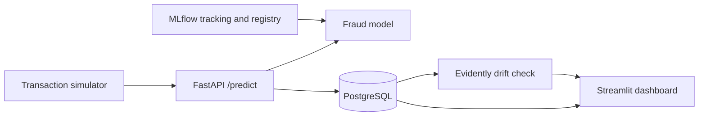

# Real-Time Credit Card Fraud Detection with ML Monitoring

An end-to-end MLOps project: a fraud model served through an API, every prediction logged to a database, and a monitoring layer that warns when incoming data drifts away from what the model was trained on.

> Items marked **[TODO]** need your own numbers or names. Replace them, then delete this line.

## Why this project

Fraud is rare (under 0.2% of transactions in the Kaggle dataset), so accuracy alone is misleading, and a model that was good at launch can quietly get worse as customer behaviour changes. This project builds both parts: a detector and a watcher.

## What it does

- Trains and compares three models (Logistic Regression, Random Forest, XGBoost) with imbalance handling.
- Chooses the alert threshold on validation data, not on the test set.
- Tracks experiments and registers the chosen model with MLflow.
- Serves predictions through a FastAPI service with input validation.
- Logs every request and prediction to PostgreSQL, and handles a database outage safely.
- Simulates live traffic, then compares predictions with ground-truth labels on a Streamlit dashboard.
- Produces Evidently drift reports with calibrated alert logic.
- Runs all services together with Docker Compose.

## Architecture



## Tech stack

| Area | Tools |
|---|---|
| Modelling | Python, pandas, scikit-learn, imbalanced-learn, XGBoost |
| Experiment tracking | MLflow |
| API | FastAPI, Pydantic, Uvicorn |
| Database | PostgreSQL, SQLAlchemy |
| Dashboard | Streamlit, Plotly |
| Monitoring | Evidently |
| Testing | Pytest, httpx, Postman |
| Packaging | Docker, Docker Compose |

## Dataset

Kaggle credit card fraud dataset (`creditcard.csv`): anonymised features `V1` to `V28`, plus `Amount`, with a binary fraud label. The file is not stored in this repository. Download it from Kaggle and place it in `data/`.

## Project structure

```
credit-card-fraud-mlops/
├── api/           FastAPI service
├── dashboard/     Streamlit dashboard
├── monitoring/    Drift checks and Evidently reports
├── src/           Preprocessing, training, model code
├── notebooks/     Exploration and validation
├── models/        Saved model (final_model.joblib, git-ignored)
├── tests/         Pytest suite
├── reports/       Reports and screenshots
├── docker-compose.yml
├── requirements.txt            (everything, for development)
├── requirements-api.txt        (API image)
├── requirements-dashboard.txt  (dashboard image)
└── .env.example
```

## Method

1. **Validation:** checked types, missing values, duplicates and class balance before modelling.
2. **Chronological split:** trained on earlier transactions and tested on later ones, so the test mimics real use and nothing leaks from the future.
3. **Imbalance:** compared class weights with one resampling method, fitted only on training data.
4. **Models:** Logistic Regression, Random Forest and XGBoost, compared with PR-AUC and ROC-AUC.
5. **Threshold:** set at **0.3649**, chosen on validation data to balance precision and recall.
6. **Tracking:** every run is logged in MLflow, and the final model is registered.

## Results

| Model | PR-AUC | ROC-AUC |
|---|---|---|
| Logistic Regression | **[TODO]** | **[TODO]** |
| Random Forest | **[TODO]** | **[TODO]** |
| XGBoost | **[TODO]** | **[TODO]** |

Final model: **[TODO: name]**. Test-set precision and recall at threshold 0.3649: **[TODO]**.

Copy these numbers from the MLflow compare screen.

### Error analysis

In the simulated traffic, the model missed 8 frauds:

- 3 near-misses scored 0.14 to 0.22, below the 0.3649 threshold.
- 5 confident misses scored under 0.03.

A lower threshold could recover at most the 3 near-misses. The other 5 would need better features or more training data. The threshold was deliberately not changed to fix these, because the simulated rows come from the test set and tuning on them would leak the test set into a model decision.

## API

| Endpoint | Purpose |
|---|---|
| `GET /health` | Service status |
| `POST /predict` | Fraud probability and decision for one transaction |
| `GET /transactions` | Recent logged predictions |
| `GET /metrics` | Request counts and latency (median and p95) |

Invalid input, such as a missing feature, a negative amount or a non-numeric value, returns HTTP 422. Interactive docs are at `/docs`.

## Monitoring

`monitoring/check_drift.py` compares recent traffic with the training data and writes an Evidently report to `reports/monitoring/drift_report.html`. Alert limits are calibrated against normal noise, so an alert should mean real drift. The dashboard shows drift status, ground-truth performance and model information.

## Run it locally (Windows PowerShell)

```powershell
python -m venv .venv
.\.venv\Scripts\Activate.ps1
pip install -r requirements.txt
Copy-Item .env.example .env       # then edit the values
```

Place `creditcard.csv` in `data/`, and the trained model at `models/final_model.joblib`. Then start each part in its own terminal:

```powershell
uvicorn api.main:app --reload                                   # API
streamlit run dashboard\app.py                                  # dashboard
mlflow ui --backend-store-uri sqlite:///mlflow.db               # experiment tracking
python monitoring\check_drift.py                                # drift report
```

A local PostgreSQL database is needed for logging. The connection settings come from `.env`.

## Run it with Docker

```bash
cp .env.example .env
docker compose up --build
```

This starts PostgreSQL, MLflow, the API and the dashboard. Check `docker-compose.yml` for the exact ports. The model file is git-ignored, so copy it into `models/` before building.

## Tests

```powershell
pytest
```

24 tests cover preprocessing, model loading, prediction output, invalid requests, health, a simulated database outage, and the monitoring calculations. Postman checks (17 of 17 passed) cover the API endpoints.

## Screenshots

| | |
|---|---|
|  |  |
|  |  |
|  |  |

## Limitations

- Live traffic is simulated from held-out dataset rows, not real payments.
- Docker Compose was tested in GitHub Codespaces, not on the development laptop.
- Postman response times were distorted by load on the development laptop. Use the API's own `/metrics` latency for performance figures.
- The model, data and MLflow database are git-ignored, so a fresh clone must train or supply its own model file.
- Evaluation used one dataset with anonymised features, so real-world performance is unproven.

## Future improvements

- Test other thresholds on fresh data.
- Add features and more training data to reduce confident misses.
- Retrain automatically when drift is detected.
- Deploy to a cloud service.

## Author

**[TODO: Sasirekha]**, [GitHub profile link (https://github.com/sasirekha52)]